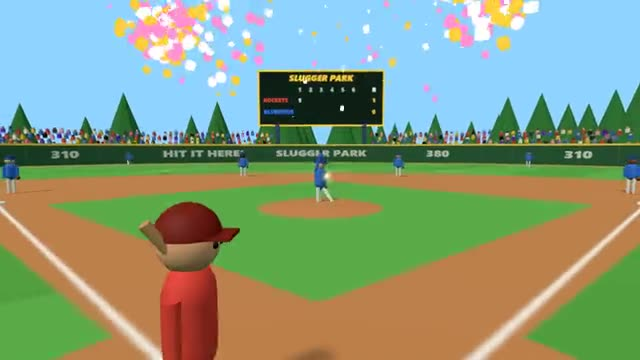

# Slugger Park

Backyard baseball. Pick your pitch, time your swing. A multiplayer starter game from [Multiplayer Agent](https://multiplayeragent.com): 3D, versus, 2–8 players, with bots that fill empty seats.

## How it plays

Pitch a fastball, curve or changeup to a spot in or out of the zone. At bat, put the ring on the ball and swing as it arrives: timing and placement decide whiff, foul, grounder, liner, fly or home run.

Two teams of four, three innings, three outs a side, with balls, strikes, fouls and walks. People on the batting team take turns at bat; on defence the pitcher's spot rotates among the people on that team. Once the ball is in play the fielders chase, catch and throw on their own: the batter can send the runners for an extra base, and the pitcher can tap a base to pick where the next throw goes.

**Controls:** Mouse to aim the ring or the pitch, click or Space to swing or throw, 1 2 3 pick a pitch · touch: drag to aim, SWING / PITCH buttons.

## Make it yours in the Game Builder

Open the [Game Builder](https://multiplayeragent.com), choose **Start from a starter game** and pick Slugger Park. It opens as version 1 in your studio, ready to play and publish. Then ask for changes, for example:

- Make it a night game under the lights with a glowing ball
- Add a knuckleball that wobbles on the way in
- Let the batter bunt by holding the swing button

## Run it yourself

1. Get a free publishable key (`pk_…`) at [multiplayeragent.com](https://multiplayeragent.com).
2. In `index.html`, put it in place of `pk_REPLACE_ME` in the `MP_CONNECT` block.
3. Serve the folder with any static web server and open it (3D games load `libs/three.module.min.js` as a module, which browsers block from a plain file). No build step and no game server needed.

Without a key it still runs, offline against bots.

## How it is built

- One `index.html`, plus three.js in `libs/`. The comment at the top of the script maps the code and explains the multiplayer.
- **Host-run rules:** The host's browser runs the fielders, throws, runners, outs and innings; if it leaves, the next player takes over.
- **Bots:** Bots fill every empty spot, so even alone you play a full four-a-side game.
- **Leaderboard:** Each player's most home runs in one game, shown on the results card.
- **Live sync:** Every pitch, swing, catch and run plays out the same on every screen.
- The batter's own screen judges its swing (timing is measured from the key or touch itself), so hitting feels right at any connection speed.
- `?attract` runs it offline with bots only. The preview video is recorded from it.

## License

MIT.
